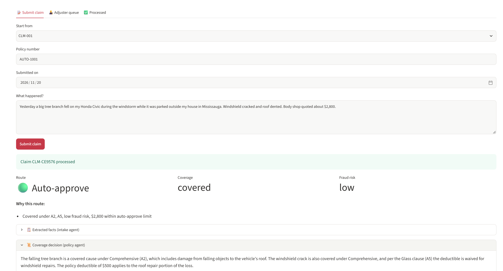
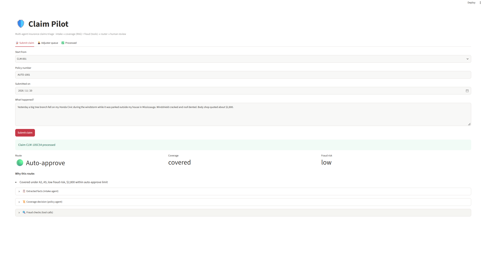
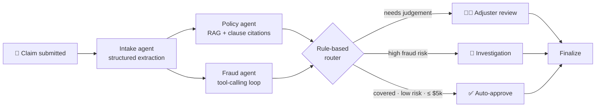

<div align="center">

# 🛡️ Claim Pilot

### Multi-agent AI system for insurance claims triage

**Reads a claim → checks coverage against policy wordings → screens for fraud → routes it → hands hard cases to a human adjuster.**


</div>

---

## TL;DR

Property & casualty insurers receive thousands of claims written in messy free text. Adjusters spend a lot of that time on routine triage: *What happened? Is it covered? Does anything look off? Who should handle it?*

**Claim Pilot automates that first pass with five cooperating components**, and it is built the way a regulated industry needs:

- 📜 **Every coverage decision cites the exact policy clause.** A guardrail rejects any citation the model wasn't given.
- 🔍 **Fraud checks use real tool calls,** not LLM guesses. The agent decides which checks to run.
- ⚖️ **Routing is done by deterministic, auditable rules.** The LLM gathers evidence; code makes the decision.
- 🧑‍⚖️ **Humans stay in control.** Anything non-routine pauses the workflow until an adjuster approves, denies or escalates.
- 📊 **An eval suite measures it,** including an LLM-as-judge that catches hallucinated evidence.

---

## 📸 Demo

| Auto-approved claim with cited clauses | Fraud case routed to investigation |
|---|---|
|  |  |

**Left:** A tree branch falls on a parked car. The policy agent cites **A2 (Comprehensive)** and **A5 (Glass)**, and works out that the deductible is waived for the windshield repair but applies to the roof. The claim is low risk and under the limit, so it is approved automatically.

**Right:** A car is stolen **3 days** after the policy started. The fraud agent calls `check_policy_age` and `find_prior_claims`, a hard business rule escalates the risk to *high*, and the claim waits in the adjuster queue for an investigation decision.

---

## 🏗️ Architecture



The policy and fraud agents run **in parallel** after intake. The router waits for both (a LangGraph fan-out/fan-in). Human review uses LangGraph's `interrupt()` with a checkpointer, so a claim can wait for an adjuster as long as it needs to and then resume exactly where it stopped.

| Component | Responsibility | How it works |
|---|---|---|
| **Intake agent** | Turns free text into a typed claim; resolves "yesterday" and "last week"; lists missing information | Pydantic structured output, with a strict "never invent facts" prompt |
| **Policy agent** | Decides coverage: `covered` / `partial` / `not_covered` / `insufficient_info` | Clause-level chunking → ChromaDB retrieval → cited decision → **citation guardrail** |
| **Fraud agent** | Screens for red flags | Hand-written **tool-calling loop**: policy age, prior claims, weather verification |
| **Router** | Chooses auto-approve, adjuster or investigation | **Deterministic Python rules.** Same input, same output, every time |
| **Human review** | Adjuster approves, denies or escalates to SIU | `interrupt()` + `Command(resume=...)` + checkpointing |

---

## 🔬 A claim, end to end

> *"My car was stolen from the mall parking lot on Nov 19… I bought the policy 5 days ago."*

```text
INTAKE    loss_type=auto_theft · incident_date=2026-11-19 · police_report=true
POLICY    covered · cites A2, A3 · deductible $500
FRAUD     → check_policy_age(AUTO-1002, 2026-11-19)   → {"days_active": 3}
          → find_prior_claims(AUTO-1002, 2026-11-19)  → {"prior_claim_count": 0}
          risk=high · "Policy only 3 days old at time of loss"
          + Rule: theft claim 3 days after policy start   (guardrail, cannot be overridden)
ROUTER    → INVESTIGATE
HUMAN     ⏸ waiting for adjuster…  → "escalate"  → final_status=escalate_by_adjuster
```

---

## 🧱 Guardrails

AI in insurance has to be explainable and controllable. These are built into the code, not just the prompts:

| Guardrail | What it prevents |
|---|---|
| **Citation verification** | If the policy agent cites a clause that wasn't retrieved, or cites nothing, its decision is downgraded to `insufficient_info`. |
| **Non-overridable business rules** | A theft claim within 30 days of policy start is *always* high risk, whatever the LLM concludes. |
| **Deterministic routing** | No LLM decides where a claim goes. Every route comes with plain-English reasons an auditor can read. |
| **Tools do the arithmetic** | Date differences are calculated in tools, not by the model (see *What the evals caught*). |
| **Human-in-the-loop by default** | Only clean, low-value, low-risk, fully covered claims skip a human. |
| **Safe checkpoint deserialization** | Only allow-listed Pydantic types can be loaded from saved graph state. |

---

## 📊 Evaluation

```bash
python evals/run_evals.py
```

Every labeled claim runs through the full graph and is scored on **7 checks**:

| Check | What it measures |
|---|---|
| Route | Did the claim reach the correct queue? |
| Incident date | Were relative dates resolved correctly, with no date invented when none was given? |
| Amount | Was the amount extracted accurately, and left blank when not stated? |
| Coverage | Correct coverage status, including partial coverage for sub-limits |
| Clauses | Did the agent cite the right policy clause? |
| Fraud | Correct risk level |
| Grounded | **LLM-as-judge:** is every fraud finding supported by the claim and the tool results? |

### Results

| Check | First full run | After eval-driven fixes |
|---|:---:|:---:|
| Routing accuracy | 6/6 | **6/6** |
| Incident date | 6/6 | **6/6** |
| Amount | 6/6 | **6/6** |
| Coverage decision | 6/6 | **6/6** |
| Clause citation | 6/6 | **6/6** |
| Fraud risk level | 5/6 | **⏳** |
| Evidence grounding | 2/6 | **⏳** |

*After-fix scores for fraud and grounding are being re-run; fixes are already in the code.*
Full report: [`evals/results.md`](evals/results.md)

### 🐛 What the evals caught

The evals found real bugs, and fixing them shaped the design:

1. **LLMs are bad at date arithmetic.** The fraud agent described a prior claim as being *"within the past year"* when it was 14 months earlier.
   → **Fix:** `find_prior_claims` now returns `days_before_incident`, so the model never does the calculation.
2. **Missing paperwork was being treated as fraud.** A rear-end collision was rated *medium* risk because there was no police report yet.
   → **Fix:** the assessment prompt now separates genuine red flags from missing documents, which the intake agent already tracks.
3. **The judge itself had a bug.** It only saw tool results, not the claim, so it flagged true statements as hallucinations.
   → **Fix:** the judge now gets the full ground truth (claim facts plus tool output) and checks factual accuracy only.

> Lesson: **evaluate the evaluator.** A judge with incomplete context reports false failures that look like model problems.

---

## 🧠 Design decisions

<details>
<summary><b>Why a rule-based router instead of an LLM?</b></summary>

Claim routing affects people's money and has to be explainable to auditors and regulators. LLMs are good at reading messy text and gathering evidence, but the final routing decision should be reproducible and traceable. Here the LLM agents produce structured evidence, and a few lines of Python turn it into a decision with readable reasons.
</details>

<details>
<summary><b>Why write the tool-calling loop by hand?</b></summary>

Prebuilt agent wrappers hide the mechanics. The fraud agent's loop (`bind_tools` → run the requested tools → return a `ToolMessage` → repeat until the model stops asking) is about 15 lines. It records a full trace that the dashboard shows, and it has an explicit step limit.
</details>

<details>
<summary><b>Why chunk policies by clause?</b></summary>

Policy wordings are already organised into numbered clauses. Chunking on those boundaries means every retrieved chunk *is* a citable unit, so citations are meaningful and easy to verify. Fixed-size chunks would split clauses and make citations ambiguous.
</details>

<details>
<summary><b>Why separate investigation from assessment in the fraud agent?</b></summary>

The investigation phase is free-form: the model chooses which tools to call. The assessment phase is a separate structured-output call that receives the full tool trace. That keeps the final output schema reliable and gives the eval judge a clean record to audit.
</details>

<details>
<summary><b>Why run policy and fraud checks in parallel?</b></summary>

They depend only on intake's output, not on each other. Running them together reduces latency, and LangGraph's fan-in waits for both before routing.
</details>

---

## 🛠️ Tech stack

| Layer | Tools |
|---|---|
| Orchestration | **LangGraph**: state graph, parallel branches, `interrupt`, checkpointing |
| LLM | **Groq** · `openai/gpt-oss-120b` (swap via one env var with `init_chat_model`) |
| Retrieval | **ChromaDB** with local MiniLM embeddings (no embedding API needed) |
| Schemas | **Pydantic v2** for every agent input and output |
| Backend | **FastAPI** (with automatic Swagger docs) |
| Frontend | **Streamlit** adjuster dashboard |
| Quality | Custom eval harness with an **LLM-as-judge** |

---

## 🚀 Quickstart

**Prerequisites:** Python 3.11+ and a free [Groq API key](https://console.groq.com).

```bash
git clone https://github.com/dilawarjavaid/claim-pilot-agent.git
cd claim-pilot-agent

python -m venv .venv
.venv\Scripts\activate            # Windows
# source .venv/bin/activate       # macOS / Linux

pip install -r requirements.txt
cp .env.example .env              # then add your GROQ_API_KEY

python scripts/ingest_policies.py # build the policy vector store
```

**Run the app (two terminals):**

```bash
uvicorn claim_pilot.api:app --reload --app-dir src   # API  → http://localhost:8000/docs
streamlit run app/dashboard.py                       # UI   → http://localhost:8501
```

**Or use the command line:**

```bash
python scripts/run_graph.py     # full pipeline, with you as the adjuster
python evals/run_evals.py       # evaluation suite
```

### API

| Method | Endpoint | Description |
|---|---|---|
| `POST` | `/claims` | Submit a claim; runs all agents and returns the decision and evidence |
| `GET` | `/claims` | List all claims and their status |
| `GET` | `/claims/{id}` | Full detail: extraction, coverage, fraud trace, route |
| `POST` | `/claims/{id}/decision` | Adjuster decision (`approve` / `deny` / `escalate`) to resume a paused claim |

---

## 📁 Project structure

```text
claim-pilot-agent/
├── src/claim_pilot/
│   ├── agents/
│   │   ├── intake.py        # free text → ExtractedClaim
│   │   ├── policy.py        # RAG coverage decision + citation guardrail
│   │   └── fraud.py         # tool-calling investigation + rule guardrail
│   ├── graph.py             # LangGraph workflow, router, human-in-the-loop
│   ├── rag.py               # clause chunking + ChromaDB retrieval
│   ├── tools.py             # policy age, prior claims, weather tools
│   ├── schemas.py           # Pydantic models for every agent contract
│   ├── policies.py          # policyholder lookup
│   ├── llm.py · config.py   # model factory (with rate-limit retries), settings
│   └── api.py               # FastAPI backend
├── app/dashboard.py         # Streamlit adjuster UI
├── data/
│   ├── policies/            # auto & home policy wordings + policyholders
│   ├── claims/              # sample claims + claim history
│   └── weather_events.json  # mock weather source
├── evals/                   # labels, eval runner, results report
├── scripts/                 # ingest, per-agent runners, graph diagram
└── docs/                    # screenshots, generated graph diagram
```

---

## 🗺️ Roadmap

- [ ] **Bigger eval set:** around 50 generated claims covering edge cases (exclusions, vacancy, rideshare use)
- [ ] **Independent judge model:** grade with a different model family to avoid self-preference bias
- [ ] **Vision agent:** estimate damage severity from claim photos
- [ ] **Real weather data:** replace the mock with the Open-Meteo historical API
- [ ] **Persistent state:** SQLite or Postgres checkpointer instead of in-memory storage
- [ ] **Observability:** LangSmith or Langfuse tracing for every agent step
- [ ] **Docker Compose:** one-command startup for the API and dashboard

---

## ⚠️ Disclaimer

All policies, policyholders, claims and weather data are **synthetic** and made up for this project. Claim Pilot is a portfolio project that shows agentic AI design patterns. It is not a production claims system.

---

<div align="center">

Built by **Dilawar Javaid** · AI Platform Engineer · [GitHub](https://github.com/dilawarjavaid)

*If you found this useful, a ⭐ is appreciated.*

</div>